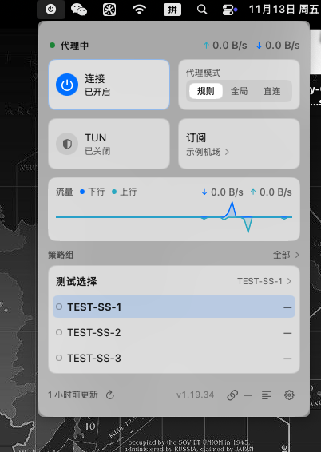
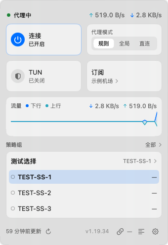
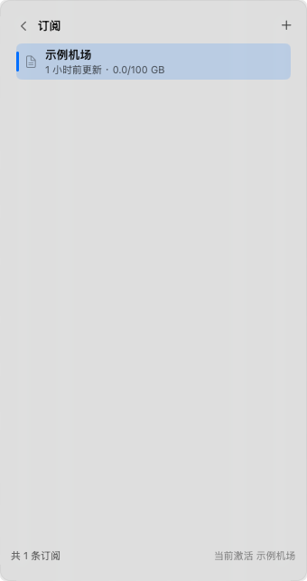
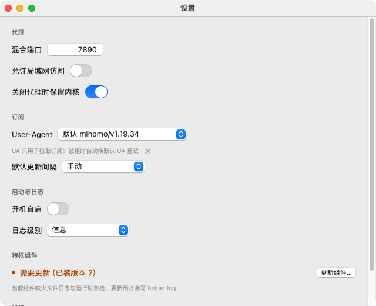

# Clash for macOS

一个住在 macOS 状态栏里的 Clash 客户端。点开就是一块控制中心式的浮层：开关、模式、节点、实时流量一屏完成，配置复杂度收进二级面板和设置窗口。



## 它是什么

- **纯状态栏应用**：`LSUIElement`，没有 Dock 图标，不占桌面
- **内核运行时下载**：首次需要内核时自动下载 [mihomo](https://github.com/MetaCubeX/mihomo)（按机器架构取 arm64 / amd64，约 20MB gz）并校验 SHA256；默认不随包分发，另提供「内置内核」变体给下载不动的网络
- **原生 SwiftUI**：面板用 `NSVisualEffectView` 材质，跟随系统深浅色、Reduce Motion、VoiceOver
- **两种接管方式**：系统代理（HTTP/HTTPS，一键开关）或 TUN（接管全部流量，需要一次管理员授权）
- **多订阅**：订阅库多条并存，单条激活，各条独立定时更新，显示到期与用量

## 界面

| 面板（系统代理接管中） | 订阅管理 |
|---|---|
|  |  |

| 设置 |
|---|
|  |

面板只有 340pt 宽，四个磁贴是全部一级动作：**连接**（系统代理开关）、**代理模式**（规则/全局/直连）、**TUN**、**订阅**。策略组卡片显示「选中项 + 延迟最低的两条」，点「全部」进完整列表。节点默认按延迟升序，未测速显示 `—`，超时才是「超时」。

## 系统要求

- macOS 15 Sequoia 及以上
- Apple Silicon（arm64）与 Intel（x86_64）都支持
- 自用构建，未签名、未公证（见「已知限制」）

### 四种包怎么选

| 你的情况 | 下载这个 |
|---|---|
| Apple Silicon（M 系列） | `Clash-<版本>-arm64.dmg` |
| Intel Mac | `Clash-<版本>-x86_64.dmg` |
| 网络下不动内核（或想装完即用） | 上面两条再加 `-kernel`，例如 `Clash-<版本>-arm64-kernel.dmg` |

一句决策树：**Intel 选 `x86_64`；网络下不动内核选带 `-kernel` 的那份**。
`-kernel` 版体积多约 25MB（压缩后），首次启动不需要联网取内核。

## 构建与运行

```bash
git clone <repo> && cd Clash

Scripts/dev-app.sh           # 构建并启动；菜单栏出现图标
# 首次点「连接」时自动下载内核；想提前预置可跑 Scripts/fetch-kernel.sh
```

首次启动没有订阅，面板会引导你导入：

- **导入订阅**：粘贴订阅链接。机场常按 User-Agent 决定返回格式，客户端默认用 `mihomo/<内置内核版本>`，被拒时自动换 UA 重试一次
- **选择 YAML**：本地已有的 Clash 配置
- 导入后会做一次 `mihomo -t` 校验，失败不会覆盖你已有的配置

想让它接管系统流量：

- **系统代理**：点「连接」即可，不需要密码；退出 App 会自动还原（含崩溃兜底）
- **TUN**：首次点会先弹本应用说明，再弹一次系统密码框安装特权组件（写入 `/Library/PrivilegedHelperTools` 与 `/Library/LaunchDaemons` 两处）；之后开关都不再问密码

## 设计上的几个明确取舍

| 事项 | 选择 | 原因 |
|---|---|---|
| 视觉语言 | 自绘控制中心风，不为 macOS 26 的液态玻璃另出皮肤 | 识别度与验收成本；系统菜单/弹窗仍跟随系统（`docs/adr/0009`） |
| 内核归属 | App 生命周期管理；v0.1 用户态直启，TUN 走特权 helper | 无开发者账号时的可行路径（`adr/0007`、`adr/0008`） |
| 配置注入 | 解析 YAML 后覆盖端口/secret/DNS，绝不字符串拼接 | 实测追加同名键会让 `mihomo -t` 直接失败（`adr/0005`） |
| 默认值 | `allow-lan: false`、控制端口与 DNS 只监听 `127.0.0.1` | 订阅里常见 `allow-lan: true` + `0.0.0.0`，照搬等于把代理暴露到局域网 |
| 内核与代理 | 完全解耦：关代理不停内核 | 否则不开代理时没法挑节点、测速 |

## 已知限制

- **未签名、未公证**：首次打开需要在「系统设置 → 隐私与安全性」里允许；组件升级要再输一次管理员密码
- **首次需要联网下载内核**（普通包）：约 20MB；GitHub 不可达时可在设置里选自动镜像（直连 → gh-proxy.com → ghproxy.net）或自定义前缀，内容始终经 SHA256 校验。确实下不动就用 `-kernel` 包
- **内置内核包承担 GPL 分发义务**：`-kernel` 变体随包分发 mihomo 与 geodata（GPL-3.0），因此包内附许可全文与源码地址；普通包只在运行时下载，见 [THIRD-PARTY-NOTICES.md](THIRD-PARTY-NOTICES.md)
- **无自动更新**：Sparkle 依赖签名，v1 改为手动下载新版
- **TUN 与其它客户端冲突**：检测到别家 TUN/VPN 已接管路由时会拒绝启动并提示
- 规则编辑器未做，只读展示

## 目录

```
Clash/            App、Features（Panel/Nodes/Subscriptions/Connections/Logs/Settings）、Core（API/Services/Storage）、UI（Tokens/Components）
Helper/           特权组件（LaunchDaemon + XPC，只有 4 个白名单方法）
Shared/           App 与 Helper 共用的 XPC 协议与 DTO
Resources/Kernel/  VERSION + SHA256-arm64 / SHA256-amd64（版本与校验依据）；内核实际下载到 ~/Library/Application Support/Clash/kernel/
docs/             产品、架构、UI 规范、ADR
Prototype/        设计验证用的可交互原型（正式工程不用它）
```

## 开发

```bash
xcodebuild -project Clash.xcodeproj -scheme Clash -configuration Debug build
Scripts/dev-app.sh            # 构建 + 启动（无 Dock 图标，看菜单栏）
Scripts/dev-app.sh --kill     # 结束实例
Scripts/check-system-proxy.sh # 系统代理快照/还原自检
Scripts/check-profile-store.sh# 订阅库导入/更新/删除自检

# 双架构 Release（默认 arm64 + x86_64 通用二进制）
xcodebuild -project Clash.xcodeproj -scheme Clash -configuration Release build

# 「内置内核」变体：先把两种架构的内核拉到 Resources/Kernel/.stage/
Scripts/fetch-kernel.sh
CLASH_BUNDLE_KERNEL=1 xcodebuild -project Clash.xcodeproj -scheme Clash \
  -configuration Release ARCHS=arm64 ONLY_ACTIVE_ARCH=NO build
```

约定与技能见 [`AGENTS.md`](AGENTS.md) 与 [`.agents/skills/`](.agents/skills/)；决策记录见 [`docs/adr/`](docs/adr/)。

## 隐私

不收集任何数据、不上报任何遥测。订阅链接只存在本地 `~/Library/Application Support/Clash/`，日志里的 secret 与 token 一律打码。

## 许可

客户端代码以 [MIT](LICENSE) 发布。

[mihomo](https://github.com/MetaCubeX/mihomo) 与 geodata（[meta-rules-dat](https://github.com/MetaCubeX/meta-rules-dat)）仍为 **GPL-3.0**，但**不随包分发**：首次使用时从官方 release 下载，应用内提供许可全文与源码链接。完整清单与 GPL 说明见 [THIRD-PARTY-NOTICES.md](THIRD-PARTY-NOTICES.md)。
