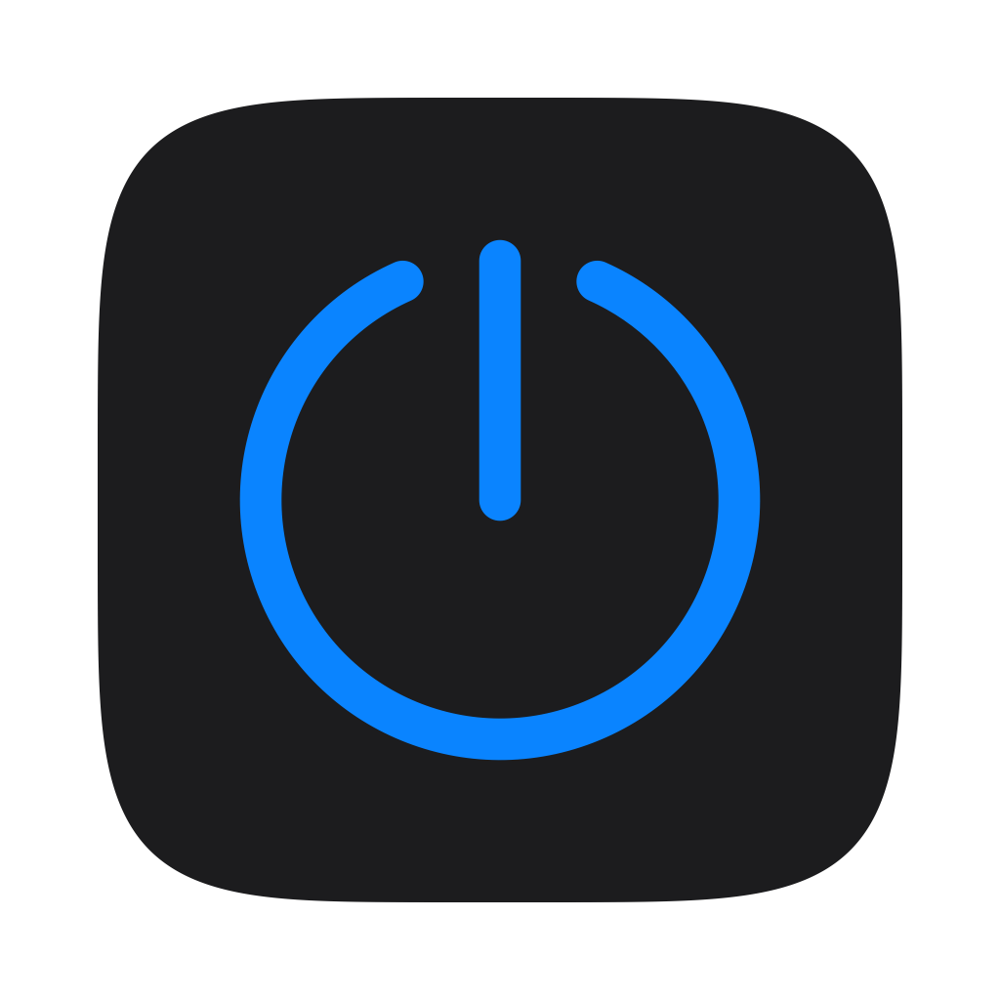
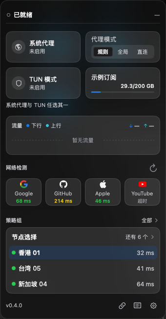
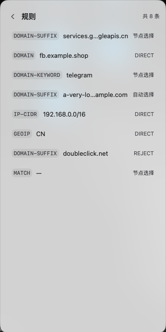
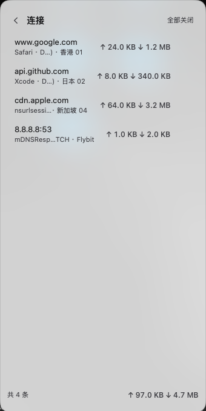
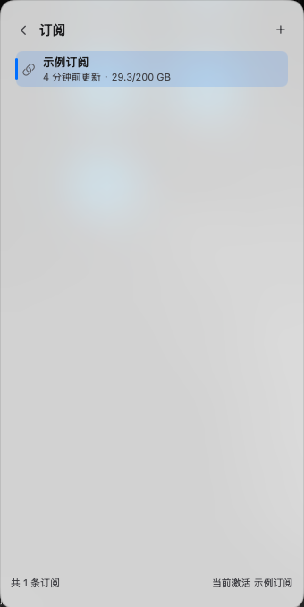
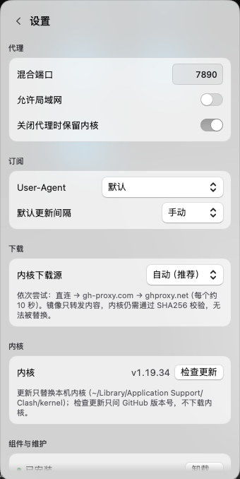

<p align="center">
  
</p>

<h1 align="center">Clash for macOS</h1>

<p align="center">
  <b>住在菜单栏里的 Clash 客户端：控制中心式的浮层，原生 SwiftUI，内核按需下载。</b><br>
  系统代理与 TUN 二选一，多订阅、策略组、规则、连接与日志，一屏之内完成。
</p>

<p align="center">
  
  
  
  
  
</p>

<p align="center">
  <a href="#特性">特性</a> ·
  <a href="#界面">界面</a> ·
  <a href="#系统要求">系统要求</a> ·
  <a href="#下载与安装">安装</a> ·
  <a href="#从源码构建">构建</a> ·
  <a href="#架构">架构</a> ·
  <a href="#第三方组件与许可">许可</a>
</p>

<br>

<p align="center">
  
  <br><sub>菜单栏面板（浅色）：两个接管方式、代理模式、订阅用量、实时流量、网络检测与策略组</sub>
</p>

<br>

## 特性

<table>
  <tr>
    <td width="50%" valign="top">
      <h3>🪟 状态栏就是主界面</h3>
      纯 <code>LSUIElement</code> 应用，没有 Dock 图标。点开菜单栏图标是一块 340pt 宽的控制中心式浮层：系统代理、TUN、代理模式、订阅、实时流量、网络检测、策略组一屏完成，更细的内容收进二级页面。
    </td>
    <td width="50%" valign="top">
      <h3>⚡ 内核按需下载，校验后再用</h3>
      默认不随包分发 <a href="https://github.com/MetaCubeX/mihomo">mihomo</a>：首次需要时按机器架构下载 arm64 / amd64，校验 SHA256，支持「直连 → gh-proxy → ghproxy」镜像回退；也可选择内置内核的安装包，装完即用。
    </td>
  </tr>
  <tr>
    <td width="50%" valign="top">
      <h3>🔀 系统代理与 TUN 任选其一</h3>
      系统代理改 macOS 网络服务的 HTTP/HTTPS 设置，退出自动还原；TUN 用一次管理员授权的特权组件接管全部流量（含 UDP）。两者互斥，界面明确提示「任选其一」。
    </td>
    <td width="50%" valign="top">
      <h3>📚 订阅库与策略组</h3>
      多条订阅并存，单条激活、独立定时更新，显示到期与用量；策略组单选（蓝底加粗），未被规则引用的组标注「未生效」；节点按延迟排序、缓存上次结果，超时才显示「超时」。
    </td>
  </tr>
  <tr>
    <td width="50%" valign="top">
      <h3>🔍 规则、连接、日志</h3>
      规则页列出每条规则的匹配类型、内容与目标（实测 515 条不卡）；连接页 2 秒刷新，显示进程、命中组与上下行速率；日志窗口只在打开时连接，支持级别过滤、暂停、清空与导出。
    </td>
    <td width="50%" valign="top">
      <h3>🧠 省内存、可反复启停</h3>
      空闲 footprint 约 28–30MB；面板首次显示才建 SwiftUI 树。单实例保护、孤儿内核开机回收、退出前还原代理并停内核，崩溃后重启也能接管现场。
    </td>
  </tr>
</table>

<br>

## 界面

| 面板 · 浅色 | 面板 · 深色 |
|---|---|
|  |  |

| 节点列表（延迟色阶 + 旗帜） | 全部策略组（单选 + 未生效） |
|---|---|
|  |  |

| 规则（515 条） | 连接（2s 刷新） |
|---|---|
|  |  |

| 订阅库 | 设置 |
|---|---|
|  |  |

面板只有 340pt 宽，四个磁贴是一级动作：**系统代理**、**代理模式**（规则 / 全局 / 直连）、**TUN 模式**、**订阅**。策略组卡片显示当前选择与最快节点，点「全部」进完整列表。

<br>

## 系统要求

| 项 | 要求 |
|---|---|
| **macOS** | **15.0 Sequoia 及以上**（`MACOSX_DEPLOYMENT_TARGET = 15.0`） |
| 架构 | Apple Silicon（arm64）与 Intel（x86_64）各一份 |
| 权限 | 仅 TUN 需要一次管理员授权（安装特权组件）；系统代理不需要密码 |
| 网络 | 普通包首次使用需能访问 GitHub（或配置镜像）；`-kernel` 包不需要 |

> 本项目为自用构建：**ad-hoc 签名、未公证**。首次打开请右键 →「打开」，或 `xattr -dr com.apple.quarantine /Applications/Clash.app`。

### 四种安装包

| 你的机器 | 下载 |
|---|---|
| Apple Silicon（M 系列） | `Clash-<版本>-arm64.dmg` |
| Intel Mac | `Clash-<版本>-x86_64.dmg` |
| 网络下不动内核 / 想装完即用 | 上面任一加 `-kernel`，例如 `Clash-<版本>-arm64-kernel.dmg` |

每个产物附同名 `.sha256`，校验：`shasum -a 256 -c Clash-...sha256`。

<br>

## 从源码构建

需要 **Xcode 16+**（Swift 6）与 macOS 15 SDK。

```bash
git clone https://github.com/yuanmaweiwu/Clash.git
cd Clash

# 开发构建 + 安装到 /Applications（默认 Release）
Scripts/install-app.sh

# 纯函数单元测试（swiftc 直编，不依赖 Xcode target）
Scripts/unit-tests.sh

# 视觉走查：用夹具渲染指定页面并截图，不启内核、不碰真实配置
Scripts/ui-preview.sh settings out.png light

# 长稳测试：按间隔采样 CPU / 内存 / 内核可达性
Scripts/soak.sh 30 baseline
```

构建内核相关功能时，脚本会自动下载内核与 geodata：

```bash
Scripts/fetch-kernel.sh                 # 下载 VERSION 指定的内核 + geodata
CLASH_BUNDLE_KERNEL=1 Scripts/install-app.sh   # 打一个内置内核的包（体积 +56MB）
```

常用调试开关（仅 DEBUG 生效）：`CLASH_PREVIEW_PAGE`、`CLASH_LATENCY_BENCH`、`CLASH_PROXY_HARNESS`、`CLASH_PROBE_HARNESS`、`CLASH_XPC_ERR_HARNESS`、`CLASH_CLEANUP_HARNESS`、`CLASH_DATA_ROOT`。

<br>

## 架构

```
Clash/
├─ App/              # NSApplication 生命周期、状态栏、面板窗口、退出清理
├─ Features/         # SwiftUI 视图：面板 / 节点 / 订阅 / 规则 / 连接 / 设置 / 日志
├─ Core/
│  ├─ Services/      # 内核生命周期、系统代理、TUN、订阅拉取、流量与测速
│  ├─ Storage/       # settings.json / profiles/index.json / 延迟缓存
│  ├─ API/           # mihomo RESTful + WebSocket 客户端
│  └─ Paths/         # 数据目录与文件布局
├─ UI/               # 设计 token（颜色、间距、圆角、字号）
Helper/              # 特权组件（LaunchDaemon）：以 root 起停内核
Shared/              # App ⇄ helper 的 XPC 协议（版本化、无任意路径参数）
```

- **AppKit 外壳 + SwiftUI 视图**：菜单栏、面板、日志窗口都由 AppKit 持有，SwiftUI 只画内容；面板用 `NSVisualEffectView` 材质，跟随深浅色与 Reduce Motion。
- **特权组件分离**：TUN 需要 root，但客户端不申请常驻特权：helper 是独立 LaunchDaemon，通过固定白名单 XPC 接收「配置正文」，路径由 helper 自己推导，调用方无法指定任意路径。
- **配置注入**：订阅 YAML 由 App 解析并注入端口、secret、模式、TUN 参数后写入运行目录，内核以独立进程启动，从不链接进 App（GPL 意义上的聚合）。
- **状态诚实**：TUN 有 30s 活性心跳；关闭失败宁可显示「内核可能仍在运行」也不谎报已关闭；清理走废纸篓可恢复。

<br>

## 第三方组件与许可

客户端代码以 [MIT](LICENSE) 发布。详细清单与 GPL 合规说明见 [THIRD-PARTY-NOTICES.md](THIRD-PARTY-NOTICES.md)。

| 组件 | 版本 | 许可 | 用途 / 分发方式 |
|---|---|---|---|
| [mihomo](https://github.com/MetaCubeX/mihomo) | v1.19.34 | **GPL-3.0** | 独立进程；普通包首次使用时下载，`-kernel` 包随包分发并附许可全文 |
| [meta-rules-dat](https://github.com/MetaCubeX/meta-rules-dat)（geoip.metadb / geosite.dat） | latest | **GPL-3.0** | 数据文件，与内核同目录；分发方式同上 |
| [Yams](https://github.com/jpsim/Yams) | 5.4.0 | **MIT** | 唯一 Swift 依赖，用于订阅 YAML 解析/注入 |

许可全文在 [`Clash/Resources/Licenses/`](Clash/Resources/Licenses/)。品牌图标（Google / GitHub / Apple / YouTube）为各自所有者的商标，仅用于网络检测功能中的识别。

<br>

## 已知限制

- 无开发者签名与公证，首次打开需右键；企业环境可能被 Gatekeeper/MDM 拦截
- 仅支持 mihomo 内核（多内核评估中，见 `docs/01-ARCHITECTURE.md`）
- 「彻底清理」会把数据移到废纸篓（可恢复），但不会自动退出 App
- 深色模式下玻璃相对更实（对比度优先），不再追求强透视

<br>

## Star History

<!-- 如果你的仓库不是 yuanmaweiwu/Clash，把下面两处 slug 换成 <owner>/<repo> -->

[](https://www.star-history.com/#yuanmaweiwu/Clash&Date)

<br>

## 致谢

- [mihomo](https://github.com/MetaCubeX/mihomo) 与 [meta-rules-dat](https://github.com/MetaCubeX/meta-rules-dat)：内核与地理数据
- [Yams](https://github.com/jpsim/Yams)：YAML 解析
- 设计参考：macOS 控制中心、[Clash Verge Rev](https://github.com/clash-verge-rev/clash-verge-rev) 与 [ClashX](https://github.com/yichengchen/clashX) 的交互取舍

<p align="center"><sub>Made for macOS, with SwiftUI. 仅用于合法网络环境下的代理管理。</sub></p>
