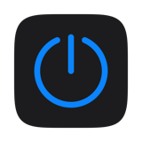
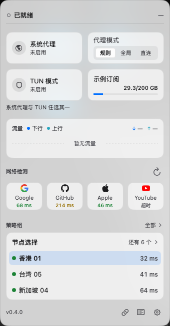
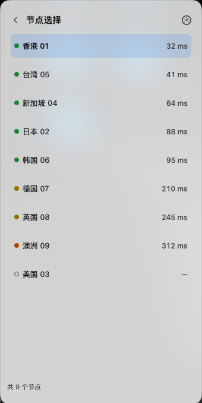
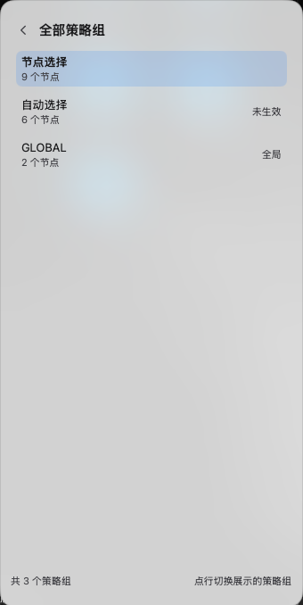

# Clash for macOS

住在菜单栏里的 Clash 客户端：控制中心式的浮层，原生 SwiftUI，内核按需下载。
系统代理与 TUN 二选一，多订阅、策略组、规则、连接与日志，一屏完成。




## 特性

- **菜单栏应用**：没有 Dock 图标，点开图标就是一块 340pt 宽的控制中心式面板。
- **内核按需下载**：首次使用时下载 [mihomo](https://github.com/MetaCubeX/mihomo)，按架构选择、SHA256 校验，镜像自动回退；也可选内置内核的安装包。
- **两种接管方式**：系统代理改 macOS 网络设置，退出自动还原；TUN 用一次管理员授权的特权组件接管全部流量。两者互斥，界面会提示「任选其一」。
- **订阅与策略组**：多条订阅并存、单条激活、独立更新，显示到期与用量；策略组单选，未被规则引用的组标注「未生效」；节点按延迟排序并缓存上次结果。
- **规则、连接、日志**：规则页逐条列出匹配与目标，连接页 2 秒刷新，日志窗口支持级别过滤、暂停与导出。
- **轻量与可恢复**：空闲内存约 30MB；单实例运行，内核异常退出或崩溃后能自动清理现场。

## 界面

面板 · 浅色


面板 · 深色


节点列表（延迟色阶 + 旗帜）



全部策略组（单选 + 未生效）



规则


连接


订阅库


设置


## 系统要求

| 项 | 要求 |
|---|---|
| macOS | **15.0 Sequoia 及以上** |
| 架构 | Apple Silicon（arm64）与 Intel（x86_64）各一份 |
| 权限 | 仅 TUN 需要一次管理员授权；系统代理不需要密码 |
| 网络 | 普通包首次使用需能访问 GitHub（或配置镜像）；内置内核的包不需要 |

本项目为自用构建，**ad-hoc 签名、未公证**。首次打开请右键 →「打开」。

### 四种安装包

| 你的机器 | 下载 |
|---|---|
| Apple Silicon（M 系列） | `Clash-<版本>-arm64.dmg` |
| Intel Mac | `Clash-<版本>-x86_64.dmg` |
| 网络下不动内核 / 想装完即用 | 上面任一加 `-kernel`，例如 `Clash-<版本>-arm64-kernel.dmg` |

每个产物附同名 `.sha256`，可用 `shasum -a 256 -c Clash-...sha256` 校验。

## 从源码构建

需要 Xcode 16+（Swift 6）与 macOS 15 SDK。

```bash
git clone https://github.com/yuanmaweiwu/Clash.git
cd Clash

Scripts/install-app.sh    # 构建 Release 并安装到 /Applications
Scripts/unit-tests.sh     # 纯函数单元测试
Scripts/ui-preview.sh settings out.png light   # 渲染指定页面截图
Scripts/soak.sh 30 baseline                    # 采样 CPU / 内存 / 内核可达性
```

需要内核时先执行 `Scripts/fetch-kernel.sh`；要打内置内核的包：

```bash
CLASH_BUNDLE_KERNEL=1 Scripts/install-app.sh
```

## 架构

```
Clash/        App（AppKit 生命周期 / 状态栏 / 面板）、Features（SwiftUI 页面）、Core（服务 / 存储 / API）
Helper/       特权组件（LaunchDaemon），以 root 起停内核
Shared/       App 与 helper 之间的 XPC 协议
```

- AppKit 持有窗口与菜单栏，SwiftUI 只负责视图；面板使用系统材质，跟随深浅色与 Reduce Motion。
- TUN 需要 root，但客户端不申请常驻特权：helper 是独立守护进程，只接受固定白名单的 XPC 调用。
- 订阅配置在本地注入端口、密钥、模式与 TUN 参数后交给内核，内核以独立进程运行。

## 第三方组件与许可

客户端代码以 [MIT](LICENSE) 发布。详细清单见 [THIRD-PARTY-NOTICES.md](THIRD-PARTY-NOTICES.md)。

| 组件 | 版本 | 许可 | 说明 |
|---|---|---|---|
| [mihomo](https://github.com/MetaCubeX/mihomo) | v1.19.34 | GPL-3.0 | 独立进程；普通包首次使用时下载，`-kernel` 包随包分发并附许可全文 |
| [meta-rules-dat](https://github.com/MetaCubeX/meta-rules-dat) | latest | GPL-3.0 | `geoip.metadb` / `geosite.dat`，分发方式同上 |
| [Yams](https://github.com/jpsim/Yams) | 5.4.0 | MIT | 订阅 YAML 解析与注入 |

品牌图标（Google / GitHub / Apple / YouTube）归各自所有者，仅用于网络检测中的识别。

## 已知限制

- 无开发者签名与公证，首次打开需要右键
- 目前只支持 mihomo 内核

## 关于「纯 AI 开发」

本项目的代码、测试、夹具与文档由 AI 编码代理在人工需求与验收下完成：

- **人负责**：产品范围、交互与视觉取舍、真机验收、发布决策
- **AI 负责**：实现与重构、真机自检夹具、性能与内存测量、文档与提交信息
- **可追溯**：每一轮改动都有审核记录（`docs/AUDIT-*.md`、`docs/CODE-REVIEW.md`）与对应的单元测试（`Scripts/unit-tests.sh`）

## Star History

<!-- 仓库名不是 yuanmaweiwu/Clash 时，替换下面两处 slug -->

[](https://www.star-history.com/#yuanmaweiwu/Clash&Date)

## 致谢

- [mihomo](https://github.com/MetaCubeX/mihomo) 与 [meta-rules-dat](https://github.com/MetaCubeX/meta-rules-dat)
- [Yams](https://github.com/jpsim/Yams)
- 交互参考：[Clash Verge Rev](https://github.com/clash-verge-rev/clash-verge-rev)、[ClashX](https://github.com/yichengchen/clashX)

仅用于合法网络环境下的代理管理。
